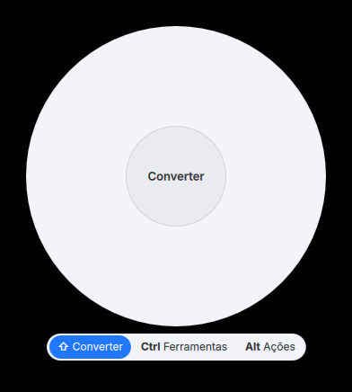
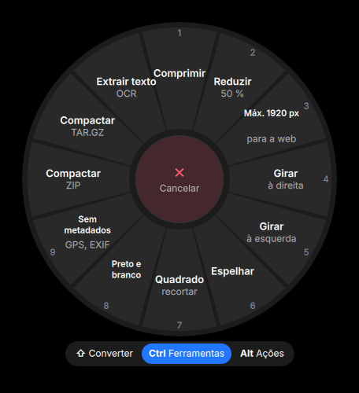

# Ações de arquivo (lingmo-fileaction)

Click-free file conversion for the Lingmo desktop: **drag a file, tap a key, drop it on a wheel**.

Baseado no FileAction (MIT) de Metamorfolog, inspirado no Tangerine. *(Based on
[FileAction](https://github.com/Metamorfolog/file_action) (MIT) by Metamorfolog, inspired by
[Tangerine](https://tangerineformac.com/) for macOS.)* The conversions are FileAction's own code, in our fork
[lingmo-fileaction-engine](https://github.com/ArchLingmo/lingmo-fileaction-engine) (C#, kept close to upstream,
see its `LINGMO.md`); this repository is the Lingmo side.

| | |
|---|---|
|  |  |

## How it works

1. Drag a file (from Lingmo Files, the desktop, a browser, any app that drags files).
2. While dragging, **tap** a key: the wheel opens under the pointer.

   | Key | Wheel | |
   |---|---|---|
   | **Shift** | Converter | JPG, PNG, WebP, AVIF, PDF, MP3, MP4, GIF, DOCX, XLSX… depending on the file |
   | **Ctrl** | Ferramentas | compress, shrink, rotate, mirror, crop, trim, merge, split, OCR, archive… |
   | **Alt** | Ações | copy to…, move to…, copy path, terminal here, share |

3. Drop the file on a slice. The result is saved **next to the original with a new name**
   (`photo.webp`, `photo (2).webp`…); the original is never changed or overwritten. Drop in the middle to cancel.

Tapping another key switches wheels; the same key again (or **R**) turns the wheel into one slice that **repeats
the last action** with the same settings. Holding Shift/Ctrl/Alt to choose copy/move in a file manager is not a tap
(press and release within 300 ms, nothing else in between) and works as always.

**Keyboard:** **Meta+Shift+A** opens the wheel for the files selected in Lingmo Files, or the files/picture on the
clipboard (a screenshot is saved to `~/Downloads/FileAction` first). Arrows choose, **Enter** runs, **Tab** switches
wheels, **Esc** closes, **1–9** run a slice. In Lingmo Files: right-click › **Converter…** / **Ações de arquivo…**.

**Progress** shows in the status bar's Island, with **Cancelar** while it runs and **Abrir** / **Mostrar na pasta**
when it is done.

**App actions** (Assistant, Flows, Spotlight, `lingmo-intent`): `files.convert` (file + format), `files.compress`,
`files.actions.list`:

```sh
lingmo-intent run files.convert --param file=~/Imagens/foto.heic --param to=jpg
```

Formats need: FFmpeg (audio/video, installed with the package), Pandoc (`pandoc-cli`, documents) and LibreOffice
(`libreoffice-fresh`, Office files) are optional; without them their slices are dimmed and say what is missing.

## Parts

| | |
|---|---|
| `src/gesture.cpp` | X11 only: XInput2 **raw** key/button events (observed, never grabbed) + XFixes on `XdndSelection` tell "a drag is in progress" and "Shift/Ctrl/Alt was tapped" |
| `qml/Wheel.qml` | the wheel: a frameless, always-on-top window with `LingmoUI.GlassSurface`, light/dark, a `DropArea` that takes the XDND drop (always as a copy) |
| `src/wheel.cpp` | the three wheels, repeat, the Actions wheel, the keyboard path (Lingmo Files selection over D-Bus, clipboard) |
| `src/jobs.cpp`, `qml/Shell.qml` | one `lingmo-fileaction-engine run --json` per job; one `LingmoUI.IslandActivity` per job |
| `src/intents.cpp`, `data/intents/` | Lingmo Intents on `com.lingmo.FileAction /Intents` |
| `data/lingmo-fileaction-daemon.desktop` | `/etc/xdg/autostart`: `lingmo-fileaction --daemon` for the gesture |

```
lingmo-fileaction                          the settings window (the menu and Spotlight open this)
lingmo-fileaction --wheel convert          the wheel as a drop zone at the pointer
lingmo-fileaction FILE...                  the wheel for these files (--wheel convert|tools|actions)
lingmo-fileaction --keyboard               Meta+Shift+A
lingmo-fileaction --daemon                 the session daemon (gesture, D-Bus com.lingmo.FileAction, intents)
lingmo-fileaction --settings               the settings window (also the gear on the wheel and the app menu)
lingmo-fileaction --about
```

## Settings

`lingmo-fileaction --settings` (`qml/Settings.qml`, `src/prefs.cpp`), also from the gear on the wheel and the app
menu. In the daemon's process when it runs, so changes apply at once.

| Page | What | Stored in |
|---|---|---|
| General | how to use; start with the session; where results go (next to the original or a folder); after finishing: Island, open the folder | `~/.config/autostart/lingmo-fileaction-daemon.desktop` (`Hidden=true` = off); `OutputDirectory` in `settings.json`; `after/*` in `fileaction.conf` |
| Gestures and keys | drag gesture on/off, tap time, which wheel Shift/Ctrl/Alt open, the keyboard shortcut | `gesture/*` in `fileaction.conf`; the `[<keys>]` group with `Exec=lingmo-fileaction --keyboard` in `~/.config/lingmoglobalshortcutsrc` (lingmo-core's chotkeys reloads it) |
| Wheels | per wheel and file type: show/hide, favourite (first, in starring order), up/down, reset, live preview with the real `WheelRing.qml`; Actions: how many "Open with" apps (0–4) | `HiddenOperations`, `FavoriteOperations` in `settings.json` (upstream's lists); `wheels/order_<wheel>`, `wheels/openWith` in `fileaction.conf` |
| Quality | JPG/WebP/AVIF quality, Compress, GPS removal, PDF page DPI, video quality, video compression | `Quality` in `settings.json` (FileAction's `Settings`: `JpegQuality`, `CompressQuality`, `StripLocation`, `PdfDpi`, `VideoCrf`, `CompressVideoCrf`) |
| Helper programs | LibreOffice, Pandoc, Tesseract (+ languages), Chromium: installed or not, which slices need them, Install | `pkexec /usr/lib/lingmo-store/lingmo-store-helper install …` (else `pkexec pacman -S --needed`) |
| About | version, engine version, credits, licences, links | |

`~/.config/lingmoos/fileaction.conf` also keeps the last action and the values asked for (e.g. trim times).
`settings.json` is FileAction's own `~/.config/fileaction/settings.json`: the engine reads it on every run, so the
quality, the output folder and presets made in upstream's settings window apply here too. It is edited key by key
(unknown keys kept, never replaced when it can't be parsed).

## Build

```sh
cmake -B build -G Ninja -DCMAKE_INSTALL_PREFIX=/usr && ninja -C build
LINGMO_FILEACTION_ENGINE="dotnet /path/to/lingmo-fileaction-engine.dll" build/lingmo-fileaction --daemon
```

Translations: `lupdate -no-obsolete -locations none src qml -ts translations/lingmo-fileaction_pt_BR.ts` and
`python3 translations/fill_pt_BR.py translations/lingmo-fileaction_pt_BR.ts` (the "Engine" context holds the
English slice names of the engine).

## Tests

`tests/e2e.sh OUTDIR light|dark` runs everything in a throwaway session (own Xvfb, scratch HOME, private D-Bus
with no service directories, a fake Island that logs what it is told): a real XDND drag from a Qt window driven
by xdotool, Shift tap → wheel → drop on WEBP; Shift twice → repeat; drop in the middle; held Shift; Ctrl/Alt
switching; WAV → MP3, MP4 → GIF; keyboard; drop zone; Cancel from the Island; `lingmo-intent run files.convert`;
and, with `FM_BUILD=<lingmo-filemanager build>`, the Lingmo Files selection over D-Bus.

## Not done yet

- Watched folders (upstream has them in its Avalonia app); the engine side exists in FileAction.Linux
  (`FolderWatcher`), a Lingmo settings page and a `watch` command in the engine are needed.
- Wayland: the gesture is X11 only (Lingmo runs on X11 + KWin). The wheel, Meta+Shift+A, the file manager entries
  and the app actions work anywhere.
- Presets editor (upstream's settings window); a "max size" for pictures other than the
  fixed Max 1920 px slice needs presets.
- Slices are reordered with up/down buttons, not by dragging.

## License

GPL-3.0-or-later. FileAction is MIT (see [THIRD-PARTY-NOTICES.md](THIRD-PARTY-NOTICES.md)).
